<div align="center">

<picture>
  <source media="(prefers-color-scheme: dark)" srcset="assets/terminal-dark.svg">
  <source media="(prefers-color-scheme: light)" srcset="assets/terminal-light.svg">
  
</picture>

<br>

<a href="https://saeed-abass.github.io"></a>
<a href="https://saeed-abass.github.io"></a>
<a href="https://www.linkedin.com/in/abass-saeed-mohammed/"></a>
<a href="mailto:saeed.abass1002@gmail.com"></a>

<a href="https://github.com/saeed-abass/saeed-abass/actions/workflows/ci.yml"></a>
<a href="https://github.com/saeed-abass/saeed-abass/actions/workflows/fraud-desk.yml"></a>

</div>

---

### 🕵️ Fraud Desk: you vs my model

<!-- FRAUD-DESK:START -->
**Case #2** has just landed on the desk. Fraud or genuine? Make the call:

| 🏪 Merchant | 💷 Amount | 🕒 Time | 🌍 Country | 📱 Device | 🔁 Attempts (2 min) | 🛒 Channel |
|---|--:|:-:|:-:|---|:-:|---|
| Morrisons | £1,864.67 | 15:51 | UK | new device | 1 | online |

<p align="center"><a href="https://github.com/saeed-abass/saeed-abass/issues/new?title=fraud-desk%7Cflag%7C2&body=Just%20press%20%2A%2ACreate%2A%2A%20%28or%20Submit%20new%20issue%29.%20A%20GitHub%20Action%20will%20check%20your%20answer%2C%20reply%20here%20within%20about%20a%20minute%2C%20close%20this%20issue%20and%20update%20the%20board%20on%20my%20profile."><b>🚩 FLAG AS FRAUD</b></a> &nbsp;&nbsp;·&nbsp;&nbsp; <a href="https://github.com/saeed-abass/saeed-abass/issues/new?title=fraud-desk%7Cpass%7C2&body=Just%20press%20%2A%2ACreate%2A%2A%20%28or%20Submit%20new%20issue%29.%20A%20GitHub%20Action%20will%20check%20your%20answer%2C%20reply%20here%20within%20about%20a%20minute%2C%20close%20this%20issue%20and%20update%20the%20board%20on%20my%20profile."><b>✅ LET IT THROUGH</b></a></p>

<sub>Clicking opens a pre-filled GitHub issue: press <b>Create</b>. A GitHub Actions workflow checks your call, scores my model on the same case, replies on the issue and updates this board within about a minute.</sub>

| | 👥 Everyone so far | 🤖 My model, same cases |
|---|:-:|:-:|
| Cases decided | 1 | 1 |
| Precision | 100% | 100% |
| Recall | 100% | 100% |
| F1 | **1.00** | **1.00** |

<details><summary><b>🏆 Leaderboard</b> and recent calls</summary>

| # | Detective | Cases | Correct | Best streak |
|:-:|---|:-:|:-:|:-:|
| 🥇 | @saeed-abass | 1 | 100% | 1 |

| Case | Player | Call | Truth | Model |
|:-:|---|---|---|:-:|
| #1 | @saeed-abass | 🚩 flagged ✔️ | fraud | ✔️ |

</details>

<details><summary><b>⚙️ How this works</b></summary>

1. Each case is a synthetic card transaction. Fraud usually stacks warning signals, but some fraud shows only one, and some genuine customers trip two, so no simple rule gets everything right.
2. My model is a class-weighted logistic regression trained on 30,000 synthetic transactions (held-out test F1 0.90), with its threshold tuned on a separate validation set. It sees exactly what you see.
3. Your click opens an issue; [a workflow](https://github.com/saeed-abass/saeed-abass/blob/main/.github/workflows/fraud-desk.yml) runs [the Python engine](https://github.com/saeed-abass/saeed-abass/tree/main/fraud_desk), scores you and the model, commits this board and replies to you. [Tests](https://github.com/saeed-abass/saeed-abass/tree/main/tests) run in CI on every push.
4. For the real thing on real data, see my [fraud detection project](https://github.com/saeed-abass/credit-card-fraud-detection-mlflow) (XGBoost + MLflow).

</details>
<!-- FRAUD-DESK:END -->

---

### `>_ code mode`

```python
saeed = Engineer(
    name       = "Saeed Mohammed Abass",
    role       = "Software Engineer",
    location   = "Bradford, UK",
    education  = {
        "MSc Applied Computer Science & AI": "University of Bradford, 2025-26",
        "BSc Computer Science":              "KNUST, Ghana, 2018-22",
    },
    experience = {
        "Software Engineer @ Hamaaya, Accra":                "Oct 2023 - Apr 2025",
        "Civilian Defence Staff (IT) @ Ghana Armed Forces":  "Sep 2022 - Sep 2023",
        "Web Developer Intern @ Hamaaya":                    "Sep 2021 - Dec 2021",
    },
    stack = {
        "languages": ["Python", "JavaScript", "PHP", "SQL", "TypeScript", "Java"],
        "ml_data":   ["PyTorch", "TensorFlow", "scikit-learn", "XGBoost", "LightGBM", "MLflow", "pandas"],
        "vision":    ["YOLO", "transfer learning", "Grad-CAM"],
        "eng":       ["REST APIs", "relational schema design", "Git", "CI/CD", "Docker basics"],
    },
)

saeed.looking_for()
# ['ML / AI Engineer', 'Data Scientist / Data Engineer', 'Software Engineer']

saeed.work_mode()
# 'UK: remote, hybrid or on-site'
```

---

###  Choose your class

<details>
<summary><b>🤖 ML / AI Engineer</b></summary>
<br>

| Quest | Loot |
|---|---|
| [**Archaeological artefact detection**](https://github.com/saeed-abass/archaeological-artefact-detection) (MSc dissertation) | Two-stage pipeline: YOLOv8 detection, then CNN material classification. 6 detectors and 5 classifiers benchmarked, with 5-fold CV tuning |
| [**Fraud detection with MLflow**](https://github.com/saeed-abass/credit-card-fraud-detection-mlflow) | Imbalanced learning (SMOTE, ADASYN, class weights), experiment tracking and a registered production model |
| [**Keratoconus detection**](https://github.com/saeed-abass/keratoconus-detection-transfer-learning) | Two-phase EfficientNetB4 fine-tuning with Grad-CAM explainability |

</details>

<details>
<summary><b>📊 Data Scientist / Data Engineer</b></summary>
<br>

| Quest | Loot |
|---|---|
| [**UK road collision risk scoring**](https://github.com/saeed-abass/uk-road-collision-risk-scoring) | Five years of STATS19 data, OSM road mapping, LightGBM, scaled from one city to 43,903 grid cells |
| [**Fraud detection with MLflow**](https://github.com/saeed-abass/credit-card-fraud-detection-mlflow) | Why PR-AUC beats ROC-AUC on 0.17% fraud, shown with real numbers |
| [**Plant leaf disease detection**](https://github.com/saeed-abass/plant-leaf-disease-detection) | EDA, HOG and colour features, class imbalance handling, 98.1% test accuracy |

</details>

<details>
<summary><b>🛠️ Software Engineer</b></summary>
<br>

| Quest | Loot |
|---|---|
| [**WY Crime Explorer**](https://github.com/saeed-abass/wy-crime-android-app) | Android app in Java: Google Maps, live search, role-based CRUD, PBKDF2 password hashing, Room database |
| [**Fraud Desk**](https://github.com/saeed-abass/saeed-abass/tree/main/fraud_desk) (on this page) | A game that runs inside this README: GitHub issues as input, a GitHub Actions workflow running a tested Python engine, a trained model as the opponent |
| [**Interactive terminal**](https://saeed-abass.github.io) | Terminal portfolio and Fraud Hunt speed game: vanilla JS, no framework, works on mobile |
| **Commercial work at Hamaaya** | PHP, JavaScript and Python web apps, REST APIs, CRM and third-party integrations, schema design |

</details>

---

### 🗺️ Level select

| Lvl | Project | Boss defeated | Stack |
|:-:|---|---|---|
| 1 | [Archaeological artefact detection](https://github.com/saeed-abass/archaeological-artefact-detection) | mAP@50 **0.667** detection, **86.4%** material accuracy | PyTorch, YOLO |
| 2 | [UK road collision risk scoring](https://github.com/saeed-abass/uk-road-collision-risk-scoring) | R² **0.351 → 0.410** after national scale-up | LightGBM, GeoPandas |
| 3 | [Fraud detection with MLflow](https://github.com/saeed-abass/credit-card-fraud-detection-mlflow) | **90.6%** precision, **78.6%** recall at 0.17% fraud | XGBoost, MLflow |
| 4 | [Plant leaf disease detection](https://github.com/saeed-abass/plant-leaf-disease-detection) | **98.1%** accuracy across 38 classes | TensorFlow |
| 5 | [Microneedle quality classification](https://github.com/saeed-abass/microneedle-quality-classification) | **100%** defect precision | PyTorch |
| 6 | [Keratoconus detection](https://github.com/saeed-abass/keratoconus-detection-transfer-learning) | Keratoconus AUC **0.887** | TensorFlow |
| 7 | [WY Crime Explorer](https://github.com/saeed-abass/wy-crime-android-app) | Shipped: map, search, auth, CRUD | Java, Android |

<table>
  <tr>
    <td align="center" width="33%"><a href="https://github.com/saeed-abass/archaeological-artefact-detection"></a><br><sub>Lvl 1: detect, then classify</sub></td>
    <td align="center" width="33%"><a href="https://github.com/saeed-abass/uk-road-collision-risk-scoring"></a><br><sub>Lvl 2: what drives road risk</sub></td>
    <td align="center" width="33%"><a href="https://github.com/saeed-abass/credit-card-fraud-detection-mlflow"></a><br><sub>Lvl 3: every run tracked in MLflow</sub></td>
  </tr>
</table>

---

### 🏆 Achievements unlocked

`MSc Applied CS & AI` `11 deep learning models benchmarked in one dissertation` `1 city → 43,903 grid cells` `PR-AUC over accuracy` `💼 Commercial full-stack experience`

---

<div align="center">

**📫 Respawn point:** [saeed.abass1002@gmail.com](mailto:saeed.abass1002@gmail.com) · [LinkedIn](https://www.linkedin.com/in/abass-saeed-mohammed/) · [Interactive terminal](https://saeed-abass.github.io)

</div>
